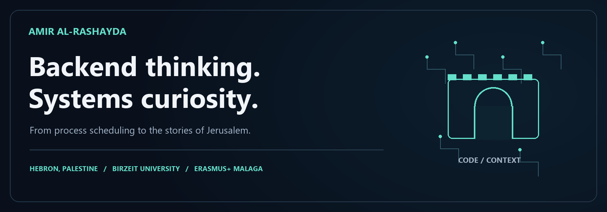

  

  <a href="https://www.linkedin.com/in/amir-al-rashayda-0750172a5/">LinkedIn</a> ·
  <a href="https://github.com/Mr-Amir-Al-Rashayda?tab=repositories">Projects</a> ·
  <a href="https://github.com/Mr-Amir-Al-Rashayda/accelerated-blahut-arimoto">Research &amp; code</a> ·
  <a href="https://github.com/Mr-Amir-Al-Rashayda/daily-code">Daily Signal</a>

## أهلاً، أنا أمير — I'm Amir

I'm a **Computer Engineering student at Birzeit University**, from **Hebron, Palestine**. My work moves between backend services, systems programming and applied AI: the API someone calls, the concurrency underneath it, and the reason the software exists in the first place.

I like making the connection between those layers visible. In my work, that has meant a C editor built around undo/redo stacks, Python experiments on channel capacity, and contributions to an Arabic-first guide to Jerusalem's places and stories.

### The experience behind the code

- **Backend training at ASAL Technologies — 347 hours.** Worked with asynchronous FastAPI services, Pydantic validation, JWT/RBAC, relational queries and indexes, and Docker-based workflows.
- **Python instructor with Gars Academy at Birzeit.** Created practical labs for first-year engineering students and helped them work through debugging, recursion and object-oriented programming.
- **Erasmus+ exchange at Universidad de Málaga — Spring 2026.** Studied automata theory, software engineering and telecommunications management alongside my degree at Birzeit.
- **Learning with other people.** AI training through Gaza Sky Geeks and Udacity, algorithmic problem solving and IEEE Xtreme participation, and workshop organization with Birzeit's Quantum Computing Club.

## Six windows into my work

<table>
<tr>
<td width="50%" valign="top">

### [Hikaya Quds · حكاية القدس](https://github.com/Mr-Amir-Al-Rashayda/hikayat-alquds)

**Team prototype · Heritage & applied AI**

Contributed as a software developer to an Arabic-first Jerusalem guide and living-memory archive. Walking itineraries, reviewed-content storytelling and visible offline fallbacks connect the software to actual places and people.

`React` `TypeScript` `NestJS` `Python` `PostgreSQL`

</td>
<td width="50%" valign="top">

### [NoteSpace](https://github.com/Mr-Amir-Al-Rashayda/NoteSpace)

**Android application · Local-first notes**

A multi-user notes app with owner-scoped SQLite operations, tags, search, favorites and email sharing. A project where interface details and data boundaries both matter.

`Java` `AndroidX` `Material 3` `SQLite`

</td>
</tr>
<tr>
<td width="50%" valign="top">

### [Channel-capacity research](https://github.com/Mr-Amir-Al-Rashayda/accelerated-blahut-arimoto)

**Research implementation · Information theory**

Blahut–Arimoto capacity estimation, a relaxed-update variant, numerical checks and the accompanying paper. The repository explains the distinction between the paper's methods and the supplied implementation.

`Python` `NumPy` `Matplotlib` `Numerical validation`

</td>
<td width="50%" valign="top">

### [Jass Nabd · جس النبض](https://github.com/Mr-Amir-Al-Rashayda/jass-nabd-emergency-orchestration)

**MENA Ignite prototype · Network APIs**

Explores responder-connectivity workflows using Nokia Network as Code / CAMARA APIs. The agent gathers bounded evidence; deterministic policy checks eligibility, and QoD requires human approval.

[Demo](https://jass-nabd-command.amir-alrashyda.workers.dev/) · [Walkthrough](https://youtu.be/ezIUkvHa_ow)

</td>
</tr>
<tr>
<td width="50%" valign="top">

### [Daily Signal](https://github.com/Mr-Amir-Al-Rashayda/daily-code)

**Automation · A small developer observatory**

Public API briefings, a rotating project spotlight and a dated AI planning journal. Source freshness is visible, and proposals stay separate from completed implementation work.

`Python` `GitHub Actions` `Public APIs` `Local Codex`

</td>
<td width="50%" valign="top">

### [Text editor with undo/redo](https://github.com/Mr-Amir-Al-Rashayda/Text-Editor-with-Undo-Redo)

**C coursework · Data structures in use**

Two stacks, a queue and linked structures behind editing, undo/redo and file persistence. One of the projects that connects algorithmic exercises to observable behavior.

`C` `Stacks & queues` `Dynamic memory`

</td>
</tr>
</table>

## Tools, organized by the work they do

| Where I work | What I use |
| :-- | :-- |
| **Backend & data** | Python · FastAPI · TypeScript · Node.js · SQL · PostgreSQL · Docker |
| **Systems & networks** | C · POSIX processes & threads · Linux · sockets · Wireshark · network simulation |
| **Applications & AI** | Java · Android · React · TensorFlow · scikit-learn · structured LLM outputs |
| **Closer to hardware** | ATmega328P · interrupts · timers · PWM · I²C · SPI · UART |

My repositories include coursework, research and prototypes. I try to make their scope clear: what runs, what was checked, and what is still a work in progress.

---

Built from Hebron, shaped at Birzeit, with a semester in Málaga — أمير الرشايدة

